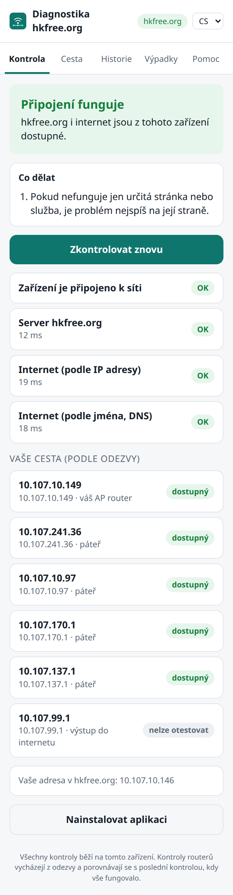
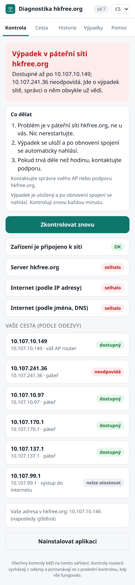
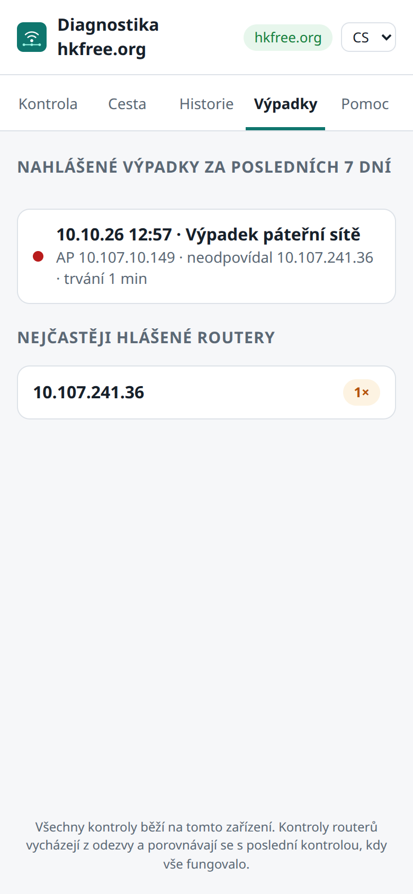
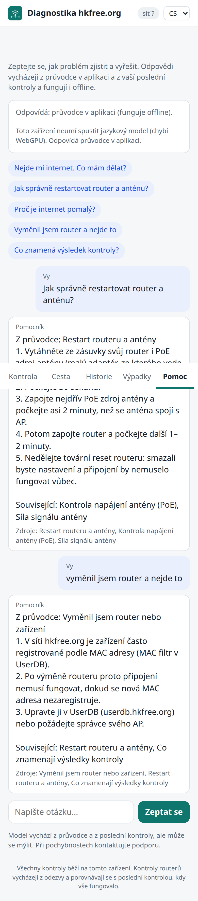

# hkdiag

*English: [README.md](README.md)*

Odpovídá na otázku „proč mi nefunguje připojení k hkfree.org?“. **Diagnostika
běží v zařízení člena**, v aplikaci (PWA), kterou si člen nainstaluje do
telefonu a která funguje i bez připojení, tedy přesně tehdy, kdy je potřeba.
Aplikace je česky, anglicky jen tehdy, když to prohlížeč upřednostňuje.

| Kontrola | Výpadek | Výpadky | Pomoc |
|---|---|---|---|
|  |  |  |  |

Záložky:
- **Kontrola:** výsledek, co dělat a jednotlivé testy.
- **Cesta:** cesta do internetu podle OSPF a zjištění.
- **Výpadky:** výpadky nahlášené členy, pro všechny, bez adres.
- **Historie.**
- **Pomoc:** poradce přímo v zařízení.

V záhlaví je vidět, jestli je zařízení v síti hkfree.org, nebo jinde.

## Specifikace, návrh, dokumentace

Projekt se vyvíjí podle [NoVibe](https://novibe.org): nejdřív specifikace,
potom návrh, nakonec kód prokázaný testy.

| Co | Kde |
|---|---|
| Specifikace (Gherkin, spustitelná) | [`features/`](features/), česky v [`docs/spec/cs/`](docs/spec/cs/) |
| Architektura (LikeC4, pohledy podle arc42) | [`docs/architecture/`](docs/architecture/); prohlížení: `npx likec4 serve docs/architecture` |
| Rozhodnutí | [`docs/adrs/`](docs/adrs/) |
| Slovník (cs/en) | [`GLOSSARY.md`](GLOSSARY.md) |
| Dokumentace (tutoriály, návody) | [`docs/cs/`](docs/cs/README.md), anglicky v [`docs/`](docs/README.md) |

Každý commit patří do jedné fáze (`spec:`, `arch:`, nebo cokoli jiného) a git
hooky v `.githooks/` to při pushi hlídají: lint specifikace, soulad české
verze, platnost modelu, fáze a žádné soubory s hesly. Relace Claude Code si je
zapnou samy; bez Claude spusťte v každém klonu jednou
`git config core.hooksPath .githooks` a pro lintery `npm install`.

## Architektura

```
 FRR 10.107.3.1 (OSPF LSDB) ─┐
 Sojka (dohled sítě) ────────┼─► hkdiag export / serve ─► topology.json ──┐
 UserDB (jména AP, volitelně)┘        (jen data)                          │
                                                                          ▼
                      telefon člena: PWA ── engine.js (analýza OSPF v zařízení)
                                         ── testy přímo ze zařízení
                                         ── výsledek (cs / en), i bez připojení
```

- **Server** jen dodává data. `hkdiag export` zapíše `topology.json`, tedy
  mapu sítě: routery, potvrzené spoje, prefixy, výstupy do internetu, jména
  AP, stav ze Sojky a dříve inzerované podsítě. Spouštějte ho z cronu a
  servírujte soubor staticky, nebo obojí nechte na `hkdiag serve`. Mapa
  obsahuje jen infrastrukturu: žádná zařízení členů, popisy ani kontakty.
- **V zařízení** (`web/engine.js` je přepis rustového jádra; obojí se
  ověřuje proti sobě na stejných testovacích datech i na živé síti):
  1. najde adresu člena podle nejdelšího prefixu (včetně VPN a statických
     tras užších než /16, přes jejich forwarding adresu);
  2. najde cestu OSPF k výstupu do internetu (E1 před E2);
  3. pozná odpojený AP router, část sítě bez výstupu, podsíť, která zmizela
     (a který router ji dřív inzeroval), routery na cestě, které hlásí Sojka,
     spoje bez zálohy a stav, kdy zbývá jediný výstup;
  4. otestuje dostupnost přímo ze zařízení a vše spojí do jednoho výsledku.

### Testy ze zařízení

Prohlížeč neumí ping, proto jsou testy dotazy HTTPS:

| Test | Jak | Spolehlivost |
|---|---|---|
| Server hkfree.org | `GET /api/whoami` (vrátí i adresu zařízení) | spolehlivé |
| Internet podle IP | `https://1.1.1.1/…` (bez DNS) | spolehlivé |
| Internet podle jména | `google.com` / `cloudflare.com` | spolehlivé; IP funguje, jméno ne → problém s DNS |
| Routery na cestě | časování TCP na `https://<router>/`: rychlá odpověď nebo odmítnutí vs. vypršení | heuristika, porovnává se s tím, jak routery odpovídaly, když vše fungovalo |
| Kontrolní adresa | `https://192.0.2.1/` (TEST-NET, nikde neexistuje) | pozná „každé spojení z tohoto zařízení okamžitě selže“ |

### Bez připojení

Service worker uloží aplikaci jako jednu ucelenou verzi. Poslední mapa sítě,
adresa zařízení, obvyklé odpovědi routerů a historie zůstávají v zařízení.
Když hkfree.org nejde, aplikace se přesto otevře, rozebere uloženou mapu (a
ukáže, jak je stará) a otestuje cestu, aby řekla, kde se spojení přerušuje: ve
vašem zařízení, u vašeho AP routeru, nebo v páteři.

### Co dělat, kontakt na podporu

Každý výsledek má konkrétní kroky: restartovat Wi-Fi nebo router,
zkontrolovat PoE zdroj antény, nebo „problém je v síti, nic nerestartujte“.
Když je problém v síti, aplikace ukáže kontakt na podporu z konfigurace
serveru:

```toml
[support]
name = "Podpora hkfree.org"
url = "https://…"        # jen https
email = "…"
phone = "…"
```

### Ukazatel sítě

Odznak v záhlaví ukazuje **hkfree.org**, **jiná síť** (třeba mobilní data)
nebo **offline**. Pozná se to podle adresy, kterou vidí server, porovnané s
mapou sítě. V jiné síti aplikace routery netestuje (zvenku nejsou dostupné),
neučí se, jak obvykle odpovídají, a výpadky nehlásí.

### Hlášení výpadků

Když kontrola zjistí problém v síti (AP router, páteř, známý problém sítě),
a ne u člena nebo až za výstupem do internetu, aplikace si výpadek uloží a
kontrolu opakuje každou minutu. Jakmile je zařízení zpět v hkfree.org,
pošle výpadek serveru (`POST /api/reports`), který ho uloží do SQLite.

- Záložka **Výpadky** (`GET /api/outages`) ukazuje všem poslední týden:
  čas, trvání, AP a router, který selhal, ale **žádné adresy členů**.
- `hkdiag reports [--hours N] [--json]` je pohled pro správce, včetně adres
  členů a nejčastěji selhávajících routerů.
- Server přijímá jen JSON ze stejného původu. Každá položka se ověřuje
  (povolené výsledky, jen IPv4, rozumné časy, omezené velikosti). Platí
  limity na klienta, odstranění duplicit podle id hlášení, uchování nejvýš
  180 dní a nejvýš 200 tisíc záznamů. Soubor databáze má práva 600.

### Poradce (záložka Pomoc)

Odpovídá v zařízení a bez připojení na otázku „jak to zjistit a opravit sám“:

1. **Vestavěný průvodce** (`web/kb.js`, cs/en): asi 14 článků (restart
   routeru a antény, PoE, Wi-Fi nebo kabel, DHCP, DNS, pomalé připojení,
   signál, výměna routeru a MAC filtr, …), prohledávaných offline. Vždy k
   dispozici.
2. **Vlastní model prohlížeče** (Chrome Prompt API), pokud umí daný jazyk.
3. **Malý otevřený model přes WebGPU** (WebLLM, přibalený ve
   `web/vendor/web-llm`, Apache-2.0): Qwen2.5 0.5B (280 MB) nebo 1.5B (870 MB).
   Stáhne se jen na výslovnou žádost, pak zůstane v zařízení pro offline
   použití a dá se zase odstranit.

> **Dohodnuto, ale zatím nepostaveno:** aplikace dostává všechna data jen přes
> náš server, takže model od výrobce prohlížeče (2.) zmizí a model (3.) bude
> v pozdějším kroku ze serveru hkfree.org místo z Hugging Face
> (`features/pomoc/poradce.feature`, `@backlog`). Do té doby kód nabízí obojí.

Modely dostanou jen odpovídající články průvodce a výsledek poslední
kontroly, mají odpovídat jen z nich a každá odpověď uvádí zdroje. Výstup se
zobrazuje jako prostý text. CSP přidává jen `'wasm-unsafe-eval'` (WebAssembly,
ne eval JavaScriptu).

### Jazyk

Výchozí je čeština. Angličtina se použije, když seznam jazyků prohlížeče
(`navigator.languages`) dává angličtinu před češtinou a slovenštinou.
Přepínač CS/EN v záhlaví to přebije a zařízení si volbu pamatuje.

## Použití

```
hkdiag serve                       # PWA + /topology.json + /api/whoami
hkdiag export --out topology.json  # jen mapa sítě (např. cron každou minutu)
hkdiag export --web /var/www/diag  # celá statická PWA + mapa sítě
hkdiag diagnose <IPv4> [--no-probe] [--member] [--json]   # diagnostika na serveru
hkdiag reports [--hours 168] [--json]                      # hlášení výpadků (správci)
hkdiag topology [--dot]            # živá páteř; `--dot | neato -Tsvg > mapa.svg`
```

Lokálně `serve` naslouchá na `127.0.0.1:8087`. Localhost se počítá jako
zabezpečený kontext, takže PWA (včetně provozu bez připojení) funguje i bez
HTTPS. Z localhostu server nepozná vaši adresu v hkfree.org, proto se na ni
aplikace zeptá.

### Nasazení na lide (aktuální)

Běží jako uživatelská služba systemd uživatele `jrk` na lide.hkfree.org a
naslouchá na `10.107.252.72:9000`, jen na adrese v hkfree.org (ne na veřejné
89.248.240.8):

```
~/hkdiag/bin/hkdiag                        # program
~/hkdiag/config.toml                       # konfigurace (práva 600)
~/hkdiag/data/                             # historie prefixů, reports.sqlite
~/.local/share/systemd/user/hkdiag.service # jednotka (odkaz v default.target.wants)
systemctl --user restart hkdiag            # po nahrání nového programu
```

Provoz bez připojení potřebuje HTTPS; pro telefony dejte před službu
virtuální host s HTTPS (viz níže).

### Nasazení s HTTPS

Telefon potřebuje pro PWA HTTPS. Buď nechte `hkdiag serve` na localhostu za
stávajícím webovým serverem:

```nginx
server {
    listen 443 ssl;
    server_name diag.hkfree.org;          # vlastní virtuální host: aplikace je v /
    # ssl_certificate ... (stávající nastavení certifikátu)
    location / {
        proxy_pass http://127.0.0.1:8087;
        proxy_set_header X-Real-IP $remote_addr;
    }
}
```

nebo ji servírujte úplně staticky: z cronu spouštějte
`hkdiag export --web /var/www/diag` a v nginx přidejte jediné dynamické místo:

```nginx
location = /api/whoami {
    default_type application/json;
    return 200 '{"ip":"$remote_addr"}';
}
```

Aplikace používá absolutní cesty (`/app.js`, `/topology.json`), takže
potřebuje kořen vlastního virtuálního hostu. Zvažte omezení hostu na adresy
hkfree.org: mapa sítě popisuje infrastrukturu sítě.

## Instalace

Sestaví se s Rustem 1.75 a novějším. `Cargo.lock` drží verze závislostí, které
s 1.75 fungují; se starým Rustem nespouštějte `cargo update`.

```
cargo build --release
install -m 755 target/release/hkdiag ~/bin/
install -m 600 -D config.example.toml ~/.config/hkdiag/config.toml   # pak upravte
```

Testy: `cargo test` (Rust) a `node --test web/test/engine.test.mjs`
(jádro v zařízení a překlady). Když se změní formát mapy sítě, obnovte
společná testovací data příkazem `HKDIAG_BLESS=1 cargo test`.

## Bezpečnost

- **Tajné údaje** (heslo FRR, API klíč, heslo člena) se berou jen z
  konfiguračního souboru nebo z proměnných `HKDIAG_*`, nikdy z příkazové
  řádky (ta je na sdíleném serveru vidět v `ps`). Konfigurační soubor musí mít
  práva 600 a patřit vám. Tajné údaje se nevypisují a po použití se z paměti
  mažou.
- **FRR:** jen čtení. Odeslat jde jen tři pevné příkazy `show ... json`, takže
  na příkazovou řádku routeru se nedostane nic od uživatele. Výstup je omezený
  a každé čtení má časový limit. Rozhraní vty je telnet, heslo jde sítí v
  čitelné podobě; používejte samostatné heslo jen pro čtení.
- **UserDB:** jen https (vynuceno), přesměrování vypnutá, aby se nepřeposlaly
  přihlašovací údaje, velikost odpovědí omezená. `app/get-token` se nikdy
  neopakuje (UserDB po 5 neúspěších adresu zablokuje).
- **Webový server:** jen GET/HEAD, kromě `POST /api/reports` (JSON ze stejného
  původu, ověřený, s limitem na klienta). Soubory aplikace jsou v programu
  (žádný přístup k souborovému systému) a server za klienta nic nedělá: mapu
  sítě sestaví nejvýš jednou za `topology_cache_secs`, ať přichází dotazů
  kolik chce, a když FRR selže, chvíli počká. `X-Real-IP` platí jen od
  `trusted_proxies`, `X-Forwarded-For` se ignoruje. Vnitřní chyby jdou jen do
  logu serveru. Přísné CSP (`default-src 'none'`, skripty a styly jen z
  vlastního původu), `nosniff`, `no-referrer`, `frame-ancestors 'none'`.
- **PWA:** mapa sítě se před použitím i uložením ověří (chybná nebo
  podvržená data se odmítnou). Žádné `innerHTML`: všechna data se vkládají
  jako text. Do adres testů jdou jen ověřené adresy IPv4 a testy neposílají
  přihlašovací údaje ani referrer.
- **Výstup příkazové řádky:** řídicí znaky z dat ze sítě se odstraňují (žádné
  podstrčené escape sekvence terminálu).
- `#![forbid(unsafe_code)]`. Zamčené závislosti ověřené proti databázi
  zranitelností OSV/RustSec.
